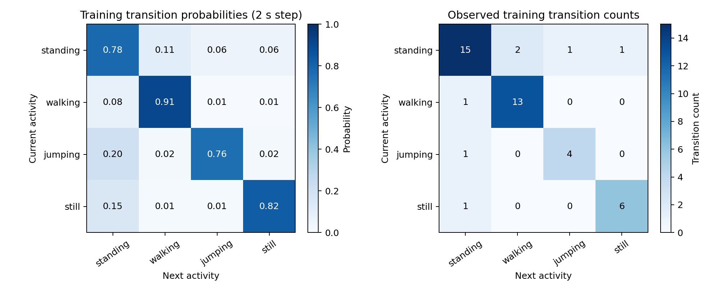
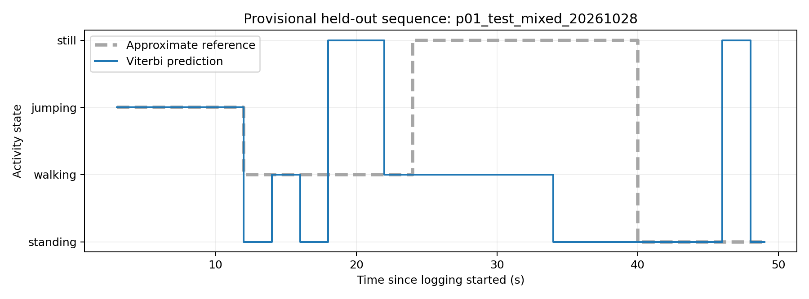
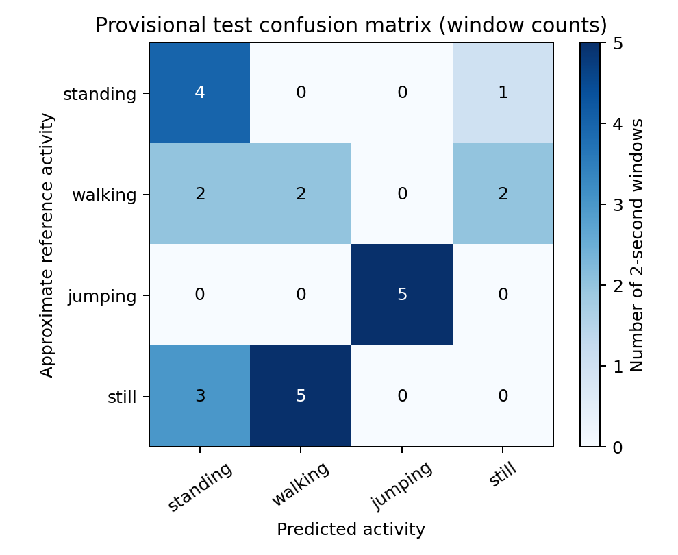

# Human Activity States Using a Hidden Markov Model

Individual iPhone study | Participant P01 | Data collected 28 October 2026

PROVISIONAL DRAFT: activity-change times were estimated, not independently recorded. Results below are conditional on approximate reference labels.

## 1. Background and motivation

Students alternate between studying, standing pauses, walking and short exercise breaks. A phone-based study-break diary could recognize these movement patterns and identify when the phone is left on a surface. Accelerometer and gyroscope measurements are noisy, so an individual reading does not directly reveal an activity. This project combines motion features with a Hidden Markov Model (HMM) to represent activity persistence and changes. Its specific question is whether one iPhone can distinguish standing while held, walking, jumping and a phone-on-surface still state in a later recording. The final state describes the device, not the person's movement away from it.

## 2. Collection and available evidence

One participant used an iPhone 13 Pro, iOS 26.5 and Sensor Logger 1.68. Metadata requests 20 ms intervals (50 Hz). Calibrated acceleration and gyroscope streams are used; uncalibrated exports are preserved but excluded. Both sensors share timestamps within each file. The measured average rates across all seven runs range from 50.1635 to 50.1705 Hz; analysis uses a common 50 Hz grid. No invalid numeric rows or duplicate timestamps were found; the largest gap is about 0.0212 s. Sources: supplied CSV/metadata and sampling_audit.csv; sensor conventions follow [1,2].

Recording; Split; Retained seconds; 2 s windows  
Jumping; train; 2-120; 59  
Standing; train; 2-120; 59  
Still; train; 2-120; 59  
Walking; train; 2-120; 59  
Mixed test; test; 2-50; 24  
Mixed train; train; 2-94; 46  
Mixed validation; validation; 2-44; 21  

Four isolated initial files and one mixed run train the model (282 windows). Distinct later logging runs supply validation (21) and test (24). They were recorded on the same afternoon, by the same person/phone; this is not a cross-day or cross-person study. The source dataset has seven recordings, not 327 independent trials.

Video evidence is included locally: standing new video.MP4 (9.77 s), jumping new video.MP4 (11.48 s), still new video.MP4 (10.33 s), and walking video.MP4 (5.23 s). Sampled still frames crop part of the person at the left edge. Accessible online video links, the author's identity and repository URL remain to be added before submission.

## 3. Preprocessing, features and reference quality

Original CSV bytes and hashes are preserved. Timestamps are sorted, invalid/duplicate rows are audited, and sensors are aligned by time rather than row number. Small jitter is regularized; a fourth-order zero-phase low-pass Butterworth filter uses a cutoff of 0.4 times the lower native/target rate before resampling. Gaps above 0.2 s would be rejected. Offline filtering uses future samples. Isolated files retain seconds 2-120 using one fixed edge rule; the mixed training end is trimmed before its final low-motion tail.

Each non-overlapping 2 s window has 100 aligned rows. Four time-domain features are acceleration-magnitude mean and standard deviation, acceleration signal magnitude area (mean |x|+|y|+|z|), and gyroscope-magnitude RMS. Four frequency features are acceleration/gyroscope dominant magnitude frequencies, acceleration 3-10 Hz power fraction relative to 0.5-10 Hz, and gyroscope AC spectral power with mean-square scaling. Dominant-frequency searches remove the mean, use a Hann taper and exclude DC. FFT bin spacing is 0.5 Hz; quiet-window peaks may represent noise.

The participant confirmed activity orders but did not measure changes. Approximate boundaries were estimated from raw-signal regime changes before new model selection. They are not independent timed ground truth. Source exports' Annotation.csv files are empty. A window uses the reference state at its midpoint. Guarded cores exclude whole windows within 2 s of any estimated interval edge; this chosen buffer is not a statistical confidence interval.

Estimated intervals (seconds since Start): **training** standing 2-8, walking 8-22, standing 22-30, jumping 30-41, standing 41-54, still 54-68, standing 68-79, walking 79-94; **validation** walking 2-12, standing 12-20, jumping 20-32, still 32-44; **test** jumping 2-12, walking 12-24, still 24-40, standing 40-50.

## 4. HMM setup and algorithms

The hidden states are standing, walking, jumping and still. Observations are eight-dimensional standardized feature vectors. Training-only means/standard deviations define scaling. A is a 4 x 4 transition matrix, pi is the start distribution, and B comprises one diagonal Gaussian density per state. Means/variances use 236 isolated training windows plus 28 guarded mixed-training windows. A and pi use the mixed training sequence only; independent files are never concatenated into artificial transitions.

Supervised parameter estimation is suitable because training activity labels are supplied. Viterbi finds the most likely full state sequence, and Forward computes sequence log likelihood. Baum-Welch is an unlabelled-data alternative and is not executed. Validation macro-F1 selects smoothing and variance floor; unseen sensitivity, specificity and accuracy assess decoded states. Higher likelihood alone does not establish better classification [3].

The fixed grid tests smoothing {0.1, 1.0} and standardized variance floors {0.05, 0.1, 0.2}. All six settings tie at validation accuracy 57.14% and macro-F1 0.569. The first fixed-grid candidate, smoothing 0.1/floor 0.05, is selected; it is not uniquely superior. Test labels do not select model settings. Implementation uses NumPy, pandas, SciPy and matplotlib; six algorithm/pipeline checks pass.

## 5. Results: transitions and provisional metrics

The training order supplies seven cross-activity changes. Standing leads to walking twice and to jumping/still once each; walking, jumping and still each return to standing once. Self-transitions dominate. This is plausible for activity persistence, but frequencies and pi reflect one scripted run. Probabilities for unobserved changes come from smoothing; they are not evidence that those changes occurred.

## Required four-state table

State; Number of samples; Sensitivity; Specificity; Overall accuracy  
Standing; 5; 80.0%; 73.7%; 45.8%  
Walking; 6; 33.3%; 72.2%; 45.8%  
Jumping; 5; 100.0%; 100.0%; 45.8%  
Still; 8; 0.0%; 81.2%; 45.8%  

Table 1. PROVISIONAL evaluation against participant-confirmed order and estimated timing. A sample is one labelled 2 s test window. Overall accuracy is a single multiclass value repeated in each row, not per-state one-vs-rest accuracy. The CSV additionally exports one-vs-rest accuracy, counts, precision and F1.

Viterbi obtains 45.83% accuracy (11/24 windows) and macro-F1 0.470. Independent Gaussian emissions obtain the same accuracy and macro-F1 0.467; the HMM's macro-F1 difference is only about 0.003. On 16 guarded-core windows, accuracy is 37.5% and macro-F1 0.431. Removing boundary neighbourhoods does not improve agreement with this reference. No uncertainty interval is claimed from these few dependent windows.

## 6. Decoded sequence and interpretation

Jumping agrees best with the supplied reference: all five jumping windows are predicted correctly, with no false jumping predictions. Standing sensitivity is 80%, walking 33.3%, and still 0%. All eight still-reference windows are predicted as standing or walking. These describe agreement with an uncertain reference, not independently established activity accuracy.

A key unresolved mismatch is that the raw test signal is very quiet around 16-23 s, followed by sustained movement around 24-39 s, whereas the participant explicitly confirmed walking before still. That order was retained rather than changed to improve scores. Without a synchronized video/time log, the contributions of model error, phone handling and reference error cannot be separated. A guarded-core score does not resolve an incorrect order or broad timing error.

## 7. Discussion, limitations and conclusion

The provisional test accuracy is lower than validation (45.83% versus 57.14%), so this experiment does not demonstrate reliable recognition in the later run. Viterbi changes some window decisions but does not improve overall accuracy over independent emissions. A transition model can suppress isolated errors, but a mismatched emission pattern or strong persistence can also erase short activities. With only one mixed training run, the transition estimates and start distribution have limited support.

Large periodic motion helps explain jumping agreement, while standing/still both have low motion and may overlap under sensor noise and hand movement. The quiet/moving test-order mismatch limits any claim that still is intrinsically the hardest class. Different grip or pace could shift features, but no measured placement-change log was supplied, so this remains a possible explanation rather than an observed cause.

Sampling is consistent near 50 Hz, with no detected long gaps; it is unlikely to be the main technical failure here. Filtering reduces high-frequency noise but changes the spectrum, 2 s windows mix transitions, and magnitude features discard direction. Diagonal Gaussians ignore correlations and may not represent multimodal activities. Long isolated training files contribute many correlated windows, not many independent trials. The short same-day test cannot support claims about other people, devices, environments or long-term behaviour.

The highest-priority improvement is independently timed annotation: record a synchronized full-run video or activity-change log and verify the test intervals without consulting model predictions. If the current test influences redesign, collect another untouched timed test. Add more continuous training transitions and independent sessions, standardize phone placement, then consider feature selection, richer emissions or duration-aware models using validation data only. Additional participants/phones would enable broader generalization assessment.

In conclusion, the project provides a reproducible four-state NumPy HMM pipeline with real iPhone data, both feature domains, a transition heatmap, decoded sequence and conditional metrics. It does not yet establish dependable activity recognition. The approximate reference times must be verified, video framing checked, accessible evidence links added and the repository published before treating this draft as a final submission.

## References and reproducibility

[Sensor Logger help](https://www.tszheichoi.com/sensorloggerhelp)
[Units reference](https://github.com/tszheichoi/awesome-sensor-logger/blob/main/UNITS.md)
[HMM tutorial](https://hmmlearn.readthedocs.io/en/stable/tutorial.html)
Reproduce with human_activity_hmm.ipynb and activity_hmm.py. Inputs, annotation hashes, sampling audit, run configuration, metrics and predictions are included. Runtime: Python 3.13.0, NumPy 2.4.3, pandas 3.0.1. No external dataset or synthetic study data were substituted.

